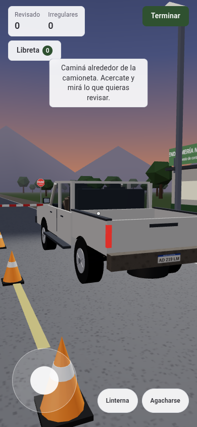

# POC: Puesto de control en ruta (Gendarmería Nacional)

Prototipo de un simulador de entrenamiento en primera persona. El usuario es un gendarme en un puesto de control fijo sobre la Ruta Nacional 34, en el norte de Salta, a las 19:50, cuando ya se puso el sol. Tiene que inspeccionar libremente una camioneta, detectar indicios sin que nadie se los señale y decidir cómo seguir el procedimiento.

**Estado:** prototipo de validación. No es una versión de producción. El procedimiento, la terminología y los indicios son ilustrativos y todavía no fueron revisados por instructores de Gendarmería ni contrastados con la normativa. La lista de lo que hay que reemplazar cuando llegue la normativa real está en [docs/normativa.md](docs/normativa.md).



## Qué cambió en esta versión

La primera versión describía los indicios con texto ("quedan unos dos dedos"). Esta versión los pone en el modelo 3D para que se **vean, se midan y se escuchen**, y cada partida es un **caso distinto que puede tener irregularidades o no**:

- **Casos variables.** Cada partida arma una camioneta a partir de una semilla: sin irregularidades, con compartimiento oculto, con patente doblada o con las dos cosas. Cada punto tiene una versión normal y una irregular, más variantes inocentes que parecen raras pero tienen explicación (carga de cemento a la vista, escape nuevo, ticket viejo de la frontera, conductor nervioso sin motivo).
- **Encuadre de cerca.** Al revisar, la cámara se acerca al punto. El panel se acomoda abajo en el celular y a la derecha en la computadora, sin tapar lo que se mira.
- **Acciones físicas.** Medir la luz entre guardabarros y cubierta, medir la caja por dentro y por fuera, golpear el piso (suena macizo o hueco), mirar la ballesta y el piso de cerca. Las medidas salen del modelo 3D, así que siempre coinciden con lo que se ve.
- **Linterna.** A esa hora, debajo de la camioneta no se ve nada sin luz.
- **Libreta.** Junta lo que se leyó, se midió y respondió el conductor, para poder comparar sin memorizar.
- **Más para comparar.** Número de chasis visible detrás del parabrisas contra la cédula, grabado del dominio contra la patente, ticket con lugar y hora contra el relato, pasarruedas que sobresalen o no del piso de la caja.
- **Conductor con conducta.** Nervioso o tranquilo según el caso: mira por el espejo cuando te acercás a la caja, tamborilea los dedos, parpadea más, tarda en contestar lo que le incomoda.
- **Sonido generado** (sin archivos): motor en ralentí, grillos y el golpe sobre el piso de la caja.
- **Registro de la partida** descargable en JSON desde el resultado, para la ronda de validación.
- **Devolución por caso:** qué había realmente en cada punto, con las medidas de esa camioneta.

## Contenido del paquete

```
gendarmeria-poc/
├── README.md                Este archivo
├── dist/
│   └── gendarmeria-poc.html Versión de un solo archivo (con three.js adentro; funciona sin internet)
├── src/                     Versión editable
│   ├── index.html           Estructura de la UI
│   ├── styles.css           Estilos y tokens de color (modo claro y oscuro)
│   ├── escenario.js         Contenido: puntos, estados, preguntas, decisiones y notas
│   ├── caso.js              Reglas que arman cada partida a partir de una semilla
│   ├── main.js              Motor: escena 3D, jugador, cámara, acciones, UI y puntaje
│   └── vendor/              three.js r128 (local) y su licencia
├── tools/                   Herramientas de desarrollo (no hacen falta para usarlo)
│   ├── build.py             Arma dist/ a partir de src/
│   ├── test-caso.js         Verifica que los casos generados sean coherentes
│   └── smoke.js             Recorrido automático con Chromium sin interfaz y capturas
└── docs/
    ├── escenario.md         Guion completo, estados posibles y reglas de puntaje
    ├── normativa.md         Qué reemplazar cuando llegue la normativa real
    ├── arquitectura.md      Cómo está construido y cómo extenderlo
    ├── validacion.md        Plan de prueba con usuarios
    ├── roadmap.md           Limitaciones conocidas y próximos pasos
    └── capturas/            Capturas en celular y escritorio
```

## Cómo correrlo

**Versión de un archivo (`dist/`).** Abrir `gendarmeria-poc.html` en cualquier navegador moderno. Trae three.js adentro, así que funciona sin internet; sin conexión solo cambia la fuente.

**Versión editable (`src/`).** Abrir `src/index.html` directamente. Para probar desde el celular en la misma red conviene servirla:

```bash
cd src
python3 -m http.server 8080
```

No hay paso de build para usar `src/`. Después de cambiar algo, `python3 tools/build.py` regenera `dist/`.

### Parámetros de la URL

| Parámetro | Para qué |
|---|---|
| `?caso=12345` | Abre un caso puntual. El número aparece en el resultado, así que se puede repetir el mismo caso o pasárselo a otra persona. |
| `?caso=original` | El caso de la primera versión, con todos los indicios a la vista. |
| `?perfil=limpio` | Fuerza el perfil (`limpio`, `oculto`, `doblada`, `completo`). Útil para instructores. |
| `?debug` | Muestra el estado real del caso en pantalla. No usar con participantes. |

## Controles

| | Celular | Escritorio |
|---|---|---|
| Caminar | Joystick abajo a la izquierda | W A S D |
| Mirar | Arrastrar en la pantalla | Arrastrar con el mouse (o flechas izquierda y derecha) |
| Revisar | Botón que aparece al mirar algo de cerca | E |
| Mirar alrededor en un encuadre de cerca | Arrastrar arriba del panel | Arrastrar con el mouse |
| Agacharse | Botón Agacharse | C |
| Linterna | Botón Linterna | F |
| Libreta | Botón Libreta | L |
| Sonido | Casilla en la pantalla de inicio | M |
| Cerrar un panel | Botón Seguir revisando | Esc |

## Cómo funciona el caso, en corto

Hay **10 puntos para revisar** y la charla con el conductor. En cada partida, `caso.js` elige un perfil y el estado de cada punto. Según el caso puede haber entre 0 y 7 indicios reales. Los textos son neutrales: los indicios aparecen al comparar (rueda delantera contra trasera, medida interior contra exterior, grabado contra patente, chapa del chasis contra cédula, ticket contra relato) o al usar la linterna debajo de la camioneta. Al terminar se elige entre 4 cursos de acción, que se califican según lo que realmente había.

El guion completo, con todos los estados y las respuestas correctas, está en [docs/escenario.md](docs/escenario.md).

## Pruebas

```bash
node tools/test-caso.js                    # 5.000 casos: coherencia de estados, respuestas y medidas
npm i --prefix tools                       # una vez, instala playwright-core
CHROMIUM=/ruta/a/chromium node tools/smoke.js /tmp/capturas "caso=original" 390 844
```

`smoke.js` recorre los 10 puntos, ejecuta todas las acciones, habla con el conductor, decide y guarda una captura por paso. Falla si algún punto no se puede revisar desde una posición alcanzable.

## Decisiones técnicas

- **three.js r128 como script global, sin build.** Permite abrir el archivo directamente y publicarlo como página única.
- **JavaScript sin framework.** La UI es chica y no lo justificaba.
- **Modelos con primitivas y texturas dibujadas en canvas.** No hay assets externos.
- **Contenido y reglas separados del motor.** Textos, estados y calificaciones en `escenario.js`; probabilidades en `caso.js`. Cambiar el procedimiento no requiere tocar `main.js`.
- **Las medidas salen del modelo.** La luz de cada rueda y la profundidad de la caja se calculan a partir de la geometría que se dibuja, así que lo que se ve y lo que se mide no se pueden contradecir.

Más detalle en [docs/arquitectura.md](docs/arquitectura.md).

## Licencias

- three.js: MIT (ver `src/vendor/LICENSE-three.txt`).
- Roboto: Apache 2.0, servida por Google Fonts.
- Código y contenido del prototipo: propios del proyecto.
